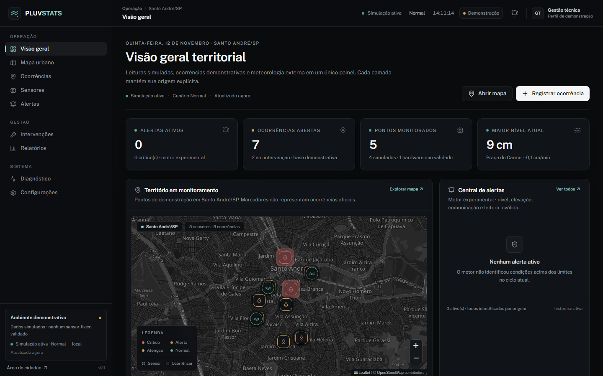

# PLUVSTATS

**Inteligência territorial para águas urbanas** · *Dados que antecipam decisões.*


<p align="center">
  
</p>

O PLUVSTATS é um protótipo acadêmico que reúne, em uma só experiência, o que a
água está fazendo em pontos de alagamento de uma cidade. Sensores medem a
distância até a água; o sistema converte essa medida em nível, velocidade de
elevação e tempo até um limite crítico, e entrega isso em duas linguagens: um
painel para a gestão municipal e uma área simples para o cidadão.

O projeto foi construído para a **Global Solution 2026.2 — CitizenTech**, com
uma regra que atravessa todas as telas: **origem, idade e limite visíveis em cada
dado**. Nada aqui é apresentado como oficial, validado em campo ou pronto para
produção.

> **Prazo da GS:** 19/11/2026, às 23h55. O plano completo — o que falta, como
> entregar, cronograma e critérios de vitória — está em
> [`PLANO-DE-ENTREGA.md`](PLANO-DE-ENTREGA.md). Checklist item a item em
> [`deliverables/checklist.md`](deliverables/checklist.md).

## Ficha da CitizenTech

| Campo | Resposta |
| --- | --- |
| **Nome da CitizenTech** | PLUVSTATS |
| **Cidade e bairro** | Santo André/SP — pontos demonstrativos em Vila Metalúrgica, Jardim, Centro, Jardim Bela Vista e Jardim Bom Pastor |
| **Cidadão beneficiado** | Moradores expostos a alagamentos — pedestres, motoristas, idosos e pessoas com mobilidade reduzida —, gestores municipais e equipes de campo |
| **Problema, em uma frase** | A informação sobre alagamentos é fragmentada, sem origem clara e difícil de transformar em decisão para o gestor e para o cidadão. |
| **Como funciona** | Sensores medem a distância até a água; o sistema converte em nível, taxa de elevação e tempo até o limite, exibe mapa, alertas, ocorrências e intervenções, e oferece uma área do cidadão. Dados simulados são identificados e há fallback local sem API. |
| **Link do repositório** | <https://github.com/1fpz/pluvstats> |
| **Indicador de impacto** | Tempo entre registro e triagem; percentual de pontos com origem e idade visíveis; ocorrências com intervenção concluída. Linha de base a medir no piloto — nenhum impacto real foi medido. |
| **ODS conectados** | ODS 6, ODS 11 e ODS 13 (detalhados abaixo) |

### O que cada parte faz

| Disciplina | Parte da solução | Onde está |
| --- | --- | --- |
| Computational Thinking with Python | aplicação de console com menu, validação e persistência JSON para operar os pontos monitorados | `python-app/` |
| Differentiated Problem Solving | modelo de nível, derivadas, integrais, limites e relatório técnico | `mathematics/` |
| Edge Computing & Computer Systems | ESP32 + HC-SR04 + LEDs + buzzer, com decisão local e Wokwi | `edge/` |
| Front-end Design | interface React/Vite/Tailwind para gestão e cidadão | `frontend/` |
| Software & Total Experience Design | problema, escopo, requisitos, caso de uso, heurísticas, tom de voz e roadmap | `design/` |
| Storytelling & Inspiração Empreendedora | arquétipo de marca, pitch de 3 minutos e e-mail ao investidor | `pitch/` |
| Web Development | interação, hooks, CRUD e integração com a API no mesmo front-end | `frontend/src/hooks`, `frontend/src/services`, `backend/` |

## Equipe

| Integrante | RM | Frente de apresentação |
| --- | --- | --- |
| Felipe Ilek | 571322 | Front-end, experiência do cidadão e identidade visual |
| Michel Tatsuya Hanada | 571987 | Backend, API, persistência e integração |
| Marcos Vinícius Tudisco | 569366 | Edge, matemática e validação de dados |

A entrega é coletiva: a coluna indica quem conduz cada bloco na banca, e todas as
partes foram revisadas em conjunto. Detalhes da organização e das evidências por
frente em [`TEAM.md`](TEAM.md).

## O problema que queremos resolver

Em um dia de chuva forte, o morador recebe informação demais e contexto de menos.
Ele vê relatos em grupos, avisos de conhecidos e talvez um número em um site —
mas não sabe **de onde veio**, **de quando é** nem **o que aquilo prova** sobre o
ponto onde está. Em risco imediato, também não sabe qual é o canal certo.

Do outro lado, quem gere a cidade tem o problema oposto: muitos sinais e pouca
base comum. Planilhas, chamados, mensagens e leituras de sensor vivem em lugares
diferentes; priorizar uma vistoria exige cruzar fontes que não conversam, e
explicar por que um ponto foi atendido antes de outro fica difícil.

O PLUVSTATS parte de uma hipótese simples: **o problema não é falta de dado, é
falta de contexto para decidir.** A solução não promete prever enchentes. Promete
organizar o sinal, mostrar a origem e dizer o limite.

### Três falhas que se somam

| Falha | Como aparece hoje | O que o projeto faz |
| --- | --- | --- |
| **Fragmentação** | chuva, relatos, planilhas e sensores em canais separados, sem horário ou ponto comum | reúne leitura, ocorrência, alerta e intervenção em um mesmo ponto no mapa |
| **Proveniência** | número sem origem e sem idade parece oficial sem ser | marca origem, idade da leitura, modo demonstração e hardware não validado |
| **Comunicação** | quem está na rua não sabe se o ponto é seguro, o que é oficial e a quem recorrer | área do cidadão com linguagem simples, texto maior e nenhum dado pessoal |

### O que é hipótese e o que é fato

Esta é uma hipótese de projeto, **não uma pesquisa de campo**. Não houve
entrevista, questionário, observação sistemática ou medição em campo nesta
entrega. O problema foi definido a partir do briefing da Global Solution e do
repertório da equipe; a validação com pessoas reais é o próximo passo, descrito
em [`design/research/research-plan.md`](design/research/research-plan.md).

O mesmo vale para os números: não há estatística de alagamento, vítima ou
prejuízo inventada neste repositório.

## Para quem o PLUVSTATS existe

| Persona (fictícia) | Quem é | O que precisa | Onde isso aparece |
| --- | --- | --- | --- |
| **Marina, 34** | moradora do entorno, usa o celular na rua com conexão instável | saber se o ponto é seguro, registrar um problema e entender os limites do canal | área do cidadão: início, mapa, registro e orientações |
| **Rafael, 41** | analista municipal de mobilidade, trabalha em desktop e precisa priorizar vistorias | distinguir simulação de hardware, ver origem do dado e acompanhar a normalização | painel de gestão: visão geral, mapa, ocorrências, alertas e intervenções |
| **Júlia, 29** | equipe de campo, vai ao ponto e registra o antes e o depois | confirmar se a leitura é física e recente, e concluir a intervenção com evidência | sensores, alertas e formulário de intervenção |

> **As personas são hipóteses declaradas.** Nomes, idades, rotinas e frustrações
> foram criados para orientar decisões de interface. Nenhuma fala ou história foi
> coletada de pessoa real. O detalhamento está em
> [`design/personas/personas.md`](design/personas/personas.md).

O cidadão beneficiado é mais amplo que a persona: pedestres, motoristas, idosos,
pessoas com mobilidade reduzida, gestores públicos e equipes de campo. A escolha
de interface prioriza quem tem menos tempo, menos conexão e menos familiaridade
com jargão técnico.

## Onde o projeto acontece

| Item | Decisão do projeto |
| --- | --- |
| **Cidade** | Santo André, Região Metropolitana de São Paulo |
| **Pontos demonstrativos** | Vila Metalúrgica, Jardim, Centro, Jardim Bela Vista e Jardim Bom Pastor |
| **Coordenadas** | aproximadas e demonstrativas; não representam ocorrências oficiais |
| **Origem dos dados** | simulação identificada (`source: "simulation"`, `simulated: true`) |
| **O que existe de real** | apenas a cidade e os nomes dos bairros |
| **O que não existe** | sensor instalado, convênio, ocorrência oficial, dado da Prefeitura ou da Defesa Civil |

A escolha por Santo André vem da proximidade com a região da equipe e da
densidade urbana do ABC paulista. Os cinco pontos servem para demonstrar o fluxo
completo — não para afirmar que um bairro específico alaga com determinada
frequência. Qualquer afirmação desse tipo exigiria série histórica oficial, que o
projeto não possui.

## Como a solução funciona

1. **Mede.** Um sensor ultrassônico (HC-SR04 no protótipo de edge) mede a
   distância até a superfície da água.
2. **Converte.** A distância vira nível: `h = H − d`, limitado à profundidade do
   canal. Leituras fora da faixa são rejeitadas.
3. **Classifica.** O nível e a taxa de elevação determinam o estado: normal,
   atenção, alerta ou crítico, com histerese para evitar oscilação.
4. **Antecipa.** Com a taxa atual, o sistema estima o tempo até o próximo limite
   e projeta a tendência.
5. **Comunica.** A gestão vê mapa, alertas, ocorrências e intervenções; o cidadão
   vê a situação do entorno em linguagem simples e registra um problema.

### Duas experiências, uma base

| Gestão | Cidadão |
| --- | --- |
| **Visão geral** — contadores, mapa, série e alertas | **Início** — situação do entorno em linguagem direta |
| **Mapa urbano** — camadas, filtros e seleção de ponto | **Mapa de atenção** — pontos próximos e legenda simples |
| **Ocorrências** — CRUD, triagem e prioridade | **Registrar problema** — tipo, local e consentimento, sem dado pessoal |
| **Sensores** — origem, idade, validação e estado | **Informações** — o que fazer, o que o canal faz e o que não faz |
| **Alertas** — severidade, métrica e recomendação | |
| **Intervenções** — vistoria vinculada à ocorrência, com nível final | |
| **Relatórios** — consolidado e exportação | |
| **Diagnóstico** — fallback, hardware e limites explícitos | |

As duas experiências compartilham a mesma configuração de limiares, o mesmo
domínio de cálculo e a mesma regra de proveniência. O que muda é a densidade e a
linguagem — não a verdade sobre o dado.

### Do número à decisão

```text
nível da água        h = H − d              (cm)
taxa de elevação     v = Δh / Δt           (cm/min)
tempo até o limite   t = (limite − h) / v  (min, se v > 0)
volume no trecho     V = w · L · Δh / 100  (m³, com Δh em cm)
exposição            E = ∫ h dt            (cm·min)
```

| Faixa | Nível de água | Taxa de elevação |
| --- | --- | --- |
| **Normal** | abaixo de 25 cm | abaixo de 1,2 cm/min |
| **Atenção** | 25 a 49,9 cm | 1,2 a 2,79 cm/min |
| **Alerta** | 50 a 74,9 cm | 2,8 a 4,49 cm/min |
| **Crítico** | 75 cm ou mais | 4,5 cm/min ou mais |

Os limiares são experimentais e vivem em
[`shared/pluvstats.config.json`](shared/pluvstats.config.json), lido pelo
frontend, pelo backend, pelo firmware e pela aplicação Python. Há histerese de
4 cm para o nível e de 0,4 cm/min para a taxa.

**Exemplo:** com o sensor a 120 cm do fundo e leitura de 112 cm até a água, o
nível é `120 − 112 = 8 cm` (normal). Se a leitura cair para 45 cm, o nível vai a
75 cm e o estado entra em crítico — desde que a taxa também sustente a mudança.

### Uma decisão por tela

A área do cidadão usa linguagem sem jargão, piso tipográfico maior e contraste
alto, porque parte do público é idosa ou está na rua com pressa. O painel de
gestão aceita densidade, mas mantém hierarquia, filtros e a origem de cada
número. Nenhuma tela pede nome, telefone, documento ou localização precisa do
cidadão.

## ODS conectados

A contribuição abaixo é **potencial e não medida**: o projeto é um protótipo
acadêmico, sem piloto real nem dados oficiais.

| ODS | Como o PLUVSTATS se conecta | Indicador que ajudaria a medir |
| --- | --- | --- |
| **ODS 6 — Água potável e saneamento** | organiza sinais de nível e drenagem em um ponto monitorado e dá visibilidade a ocorrências de alagamento | pontos com leitura válida e ocorrências de drenagem triadas |
| **ODS 11 — Cidades e comunidades sustentáveis** | aproxima gestão e cidadão com mapa, alertas e registro de problemas urbanos | tempo entre registro e triagem; ocorrências com intervenção concluída |
| **ODS 13 — Ação contra a mudança global do clima** | apoia a preparação local para chuvas intensas, com limites e incerteza explícitos | pontos monitorados com origem e idade da leitura visíveis |

A conexão é intencionalmente conservadora: o sistema **não** prevê enchentes,
não substitui a Defesa Civil e não aciona equipes. Os ODS orientam o problema e
os indicadores, não uma promessa de impacto.

## O que o projeto é — e o que ele não é

| É | Não é |
| --- | --- |
| um protótipo acadêmico funcional, com frontend, API, edge, matemática e Python | um produto em operação ou uma startup com usuários |
| uma demonstração identificada, com fallback local sem backend | um sistema oficial da Prefeitura ou da Defesa Civil |
| um modelo linear didático de nível, taxa e tempo até o limite | um modelo hidrológico calibrado ou uma previsão de enchentes |
| um firmware e um diagrama de Wokwi preparados | hardware montado, compilado ou validado fisicamente |
| uma proposta de interface para gestão e cidadania | um canal de emergência que aciona equipes ou promete resgate |
| documentação honesta do que falta validar | uma pesquisa de campo, entrevista ou medição de impacto |

Essa separação aparece na interface (selos de origem e modo), na documentação e
no pitch. Se uma afirmação não pode ser sustentada pelo que existe no
repositório, ela não entra.

## Estado do projeto

| Módulo | Estado |
| --- | --- |
| Estrutura do monorepo | Concluído |
| Design system | Concluído |
| Frontend demonstrativo (gestor e cidadão) | Concluído |
| Backend FastAPI + SQLite | Concluído |
| Simulador e motor de alertas | Concluído |
| Inteligência territorial experimental | Concluído |
| ESP32 | Firmware e diagrama prontos — **não compilados, não testados fisicamente** |
| Wokwi | Projeto pronto — **simulação não executada** |
| Módulo de matemática | Concluído (35 testes + relatório técnico) |
| Aplicação Python (menu e JSON) | Concluída (12 testes automatizados) |
| Apresentação de Experience | Concluída (7 entregáveis) |
| Pitch e branding | Concluído (roteiro, arquétipo, e-mail e deck) |
| Documentação | Concluída |

Evidências automatizadas: **23 testes de frontend, 31 de backend, 35 de
matemática, 12 da aplicação Python e 4 de sincronização de limiares**. Detalhes e
o que não foi testado em
[documentation/testing](documentation/testing/README.md).

## Tecnologias e arquitetura

| Camada | Tecnologias | Papel |
| --- | --- | --- |
| Front-end | React 19, Vite 6, Tailwind CSS 3, React Router, Recharts, Leaflet, Lucide | duas experiências, componentes reutilizáveis e mapa |
| Domínio | JavaScript puro e funções testáveis | simulação, alertas, histerese e inteligência territorial |
| API | FastAPI, Pydantic e SQLite (`sqlite3` da stdlib) | CRUD, snapshot, ingestão e validação de hardware |
| Edge | ESP32, HC-SR04, LEDs e buzzer (Arduino/C++) | decisão local mesmo sem internet |
| Matemática | Python puro, `unittest` e SVG | derivadas, integrais, limites e relatório |
| Python | biblioteca padrão, menu e JSON | operação dos pontos sem depender do frontend |
| Configuração | `shared/pluvstats.config.json` | fonte única de limiares e geometria |

```text
sensor → ESP32 → API → SQLite
                    ↓
             frontend → gestão / cidadão
                    ↘ fallback local (sem API)
```

O frontend também consome uma API externa de meteorologia (Open-Meteo) e trata
indisponibilidade com cache e aviso. Sem `VITE_API_BASE_URL`, a demonstração roda
inteira no navegador com o repositório local de dados simulados.

## Como rodar

### Pré-requisitos

- **Node.js 20+** para o frontend;
- **Python 3.11+** para backend, matemática, aplicação Python e ferramentas do edge;
- nenhuma conta, credencial ou chave de API é necessária para a demonstração.

### Demonstração em 2 minutos (sem backend)

```bash
git clone https://github.com/1fpz/pluvstats.git
cd pluvstats/frontend
npm install
npm run dev
```

Abra `http://127.0.0.1:5173`. Os dados são fictícios e aparecem identificados em
todas as telas.

Roteiro sugerido (5 minutos):

1. **Visão geral** — contadores, mapa, série do sensor e meteorologia externa.
2. **Mapa** — filtre camadas e selecione um ponto.
3. **Sensores** — compare os quatro simulados com o hardware `PS-05` **não validado**.
4. **Configurações** — escolha o cenário **Crítico** e aguarde um ciclo de 5 s.
5. **Alertas** — abra um alerta, leia as métricas e use **Reconhecer**.
6. **Área do cidadão** (`/cidadao`) — registre uma ocorrência e veja o protocolo
   demonstrativo.
7. **Configurações → Reiniciar dados** — volta ao estado inicial.

### Stack completa (frontend + API)

```bash
cd backend
python -m venv .venv
.\.venv\Scripts\python.exe -m pip install -r requirements.txt
Copy-Item .env.example .env
.\.venv\Scripts\python.exe -m uvicorn app.main:create_app --factory --host 127.0.0.1 --port 8000
```

Em Linux/macOS, os comandos equivalentes são `python3 -m venv .venv`,
`source .venv/bin/activate`, `pip install -r requirements.txt`,
`cp .env.example .env` e
`uvicorn app.main:create_app --factory --host 127.0.0.1 --port 8000`.

Depois, crie `frontend/.env` a partir de `frontend/.env.example` e defina:

```env
VITE_API_BASE_URL=http://127.0.0.1:8000
```

Se a API estiver ausente ou indisponível, o frontend retorna ao runtime
demonstrativo local e informa o fallback em **Diagnóstico**. Nenhuma credencial é
enviada ao navegador.

### Um comando (Windows)

```powershell
# Sobe API + frontend em duas janelas
powershell -ExecutionPolicy Bypass -File scripts/start-full.ps1

# Abre apenas a demonstração local, sem backend
powershell -ExecutionPolicy Bypass -File scripts/start-demo.ps1
```

### Outras partes do projeto

```bash
# aplicação Python (menu interativo e persistência JSON)
cd python-app && python app.py

# relatório consolidado, sem menu
python app.py --report

# testes da matemática
python -m unittest discover -s mathematics/tests -p "test_*.py"

# testes do gerador de limiares do edge
python -m unittest discover -s edge/tools -p "test_*.py"

# conferir se o header do firmware está sincronizado com o JSON
python edge/tools/sync_thresholds.py --check
```

O firmware ESP32 não é compilado nesta verificação e o diagrama do Wokwi não é
executado. Essas ausências estão registradas em [`edge/README.md`](edge/README.md)
e em [documentation/testing](documentation/testing/README.md).

## Deploy

O frontend foi preparado para a Vercel com `frontend/vercel.json` (build Vite e
rewrites de SPA). O passo a passo completo está em
[documentation/deploy.md](documentation/deploy.md).

Resumo:

1. Importe o repositório na Vercel e defina **Root Directory** = `frontend`.
2. Build Command = `npm run build`; Output Directory = `dist`.
3. Ative a inclusão de arquivos fora da raiz do projeto, porque o frontend lê
   `shared/pluvstats.config.json`.
4. Variável opcional `VITE_API_BASE_URL` apontando para o backend publicado.
5. Sem backend, a demonstração local continua funcionando; o **Diagnóstico**
   mostra que a API não está configurada.

> O deploy ainda **não foi publicado** pela equipe. A URL pública será adicionada
> aqui depois da publicação; enquanto isso, a entrega acadêmica usa o repositório
> e as instruções locais.

## Testes

```bash
cd frontend && npm run test && npm run lint && npm run build
cd backend && .\.venv\Scripts\python.exe -m pytest
cd .. && python -m unittest discover -s mathematics/tests -p "test_*.py"
python -m unittest discover -s python-app/tests -p "test_*.py"
python -m unittest discover -s edge/tools -p "test_*.py"
python edge/tools/sync_thresholds.py --check
```

Resultado registrado nesta entrega: **105 testes automatizados aprovados**, lint
sem erros e build do frontend concluído. O firmware não foi compilado e o Wokwi
não foi executado.

## Dados, privacidade e segurança

- Todos os dados exibidos no modo demonstração são fictícios e identificados como
  tal (`source: "simulation"`, `origin: "demonstration"`, `simulated: true`).
- O modo hardware só é habilitado após leitura física recente, estruturalmente
  válida e confirmada pela API.
- A ingestão de hardware é desabilitada por padrão
  (`PLUVSTATS_HARDWARE_ENABLED=false`).
- A área do cidadão não pede nome, telefone, documento ou localização precisa.
- Nenhum segredo, credencial real, entrevista ou teste físico é inventado neste
  repositório; `secrets.h` e arquivos `.env` não são versionados.
- Os limiares são definidos em `shared/pluvstats.config.json`, lido pelo frontend,
  backend, edge e Python.

## Estrutura

```text
pluvstats/
├── frontend/       React + Vite + Tailwind + Recharts + Leaflet
├── backend/        FastAPI + SQLite (stdlib sqlite3)
├── edge/           ESP32 + Wokwi
├── mathematics/    fórmulas, testes, gráficos e relatório
├── python-app/     aplicação de console com menu e JSON
├── shared/         configuração única compartilhada
├── design/         requisitos, personas, jornadas e apresentação
├── documentation/  arquitetura, API, decisões, testes e deploy
├── pitch/          branding, e-mail, roteiro e deck
├── scripts/        atalhos para subir a demonstração
└── deliverables/   mapa de entrega e gerador de ZIPs
```

## Documentação principal

- [Plano de entrega e de vitória](PLANO-DE-ENTREGA.md)
- [Arquitetura](documentation/architecture/overview.md)
- [Contrato da API](documentation/api/README.md)
- [Testes e evidências](documentation/testing/README.md)
- [Deploy na Vercel](documentation/deploy.md)
- [Requisitos, personas e jornadas](design/README.md)
- [Kit de conversas com pessoas reais](design/research/interview-kit.md)
- [Apresentação da disciplina de Experience](design/presentation/README.md)
- [Revisão do deck contra a rubrica](design/presentation/rubrica-review.md)
- [Demonstração de 90 segundos](deliverables/demo-90s.md)
- [Pitch e slides](pitch/README.md)
- [Aplicação Python (menu e JSON)](python-app/readme.md)
- [Relatório técnico de matemática](mathematics/report/relatorio-tecnico.pdf)
- [Checklist de entrega por disciplina](deliverables/README.md)
- [Checklist de Edge e links do Wokwi/YouTube](edge/ENTREGA.md)
- [Equipe e organização](TEAM.md)
- [Uso de IA](AI.md)
