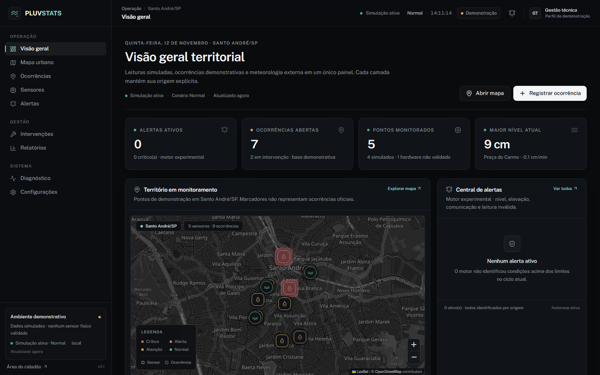
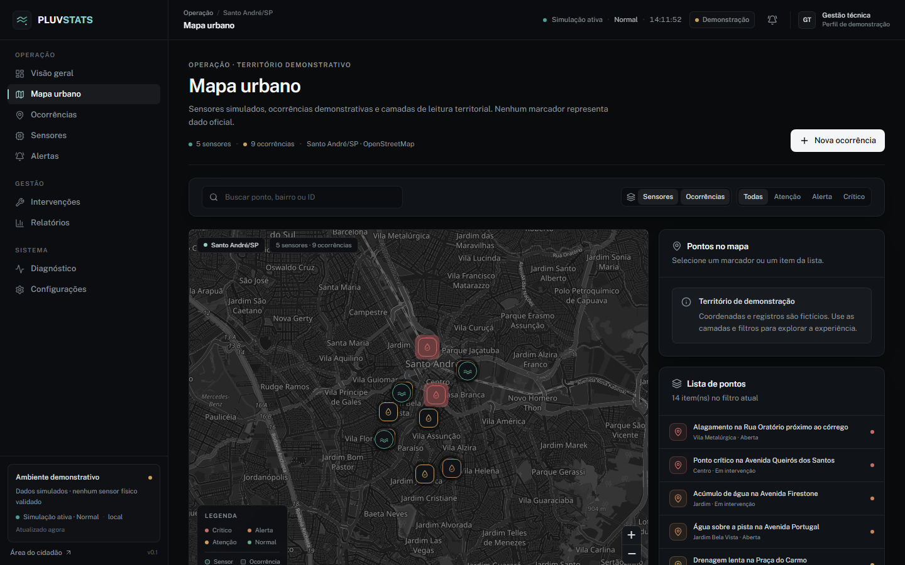
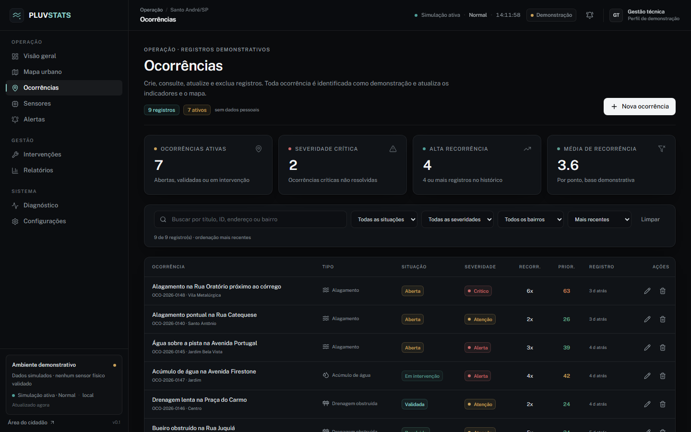
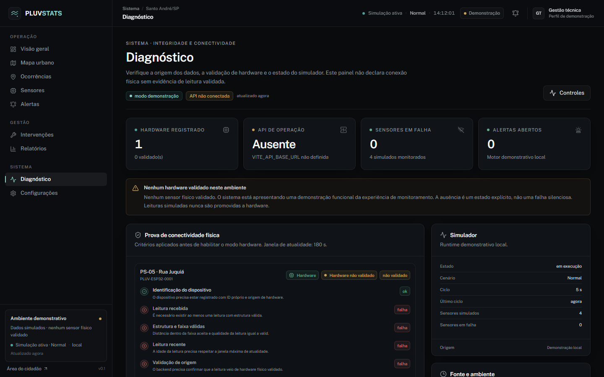
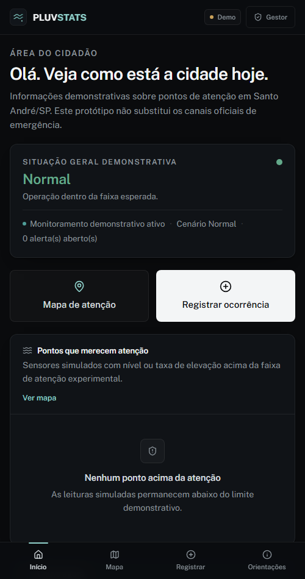
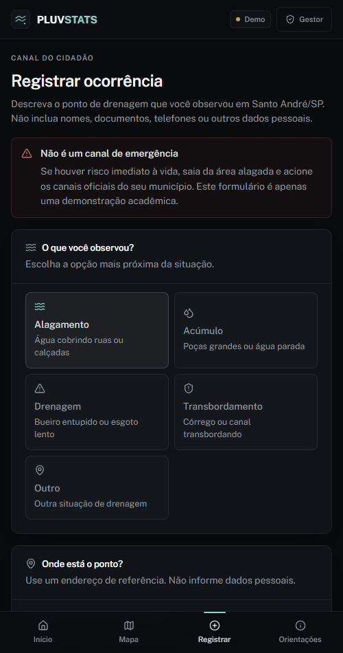
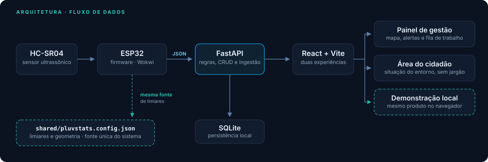

<div align="center">

# PLUVSTATS

**Inteligência territorial para águas urbanas**

*Dados que antecipam decisões.*

[](https://react.dev/)
[](https://vite.dev/)
[](https://tailwindcss.com/)
[](https://fastapi.tiangolo.com/)
[](#testes)
[](#transpar%C3%AAncia)

**[▶ Abrir a demonstração](https://pluvstats.vercel.app/)**

<sub>[Simulação do edge](https://wokwi.com/projects/480625234214048769) · [Arquitetura](documentation/architecture/overview.md) · [API](documentation/api/README.md) · [Como rodar](#rodando)</sub>

</div>

<p align="center">
  
</p>

## O que é

O PLUVSTATS organiza o que a água está fazendo nos pontos de alagamento de uma
cidade. Sensores medem a distância até a superfície; o sistema converte em
**nível**, **taxa de elevação** e **tempo até o limite crítico**, e entrega o
resultado em duas linguagens: um painel denso para a gestão municipal e uma área
simples para quem está na rua.

Uma regra atravessa todas as telas: **origem, idade e limite visíveis em cada
dado**. O sistema não prevê enchentes, não substitui a Defesa Civil e não
apresenta simulação como medição de campo.

| | |
| --- | --- |
| **Mede** | HC-SR04 no ESP32, com mediana de 5 amostras e descarte de leituras implausíveis |
| **Calcula** | nível, taxa, projeção linear, tempo até o limite, volume e exposição |
| **Comunica** | mapa, alertas, ocorrências e intervenções para a gestão; situação do entorno para o cidadão |

## Telas

<table>
  <tr>
    <td width="50%">
      
      <br><sub><b>Gestão · visão geral</b> — contadores, série temporal e central de alertas</sub>
    </td>
    <td width="50%">
      
      <br><sub><b>Gestão · mapa urbano</b> — camadas, filtros e seleção de ponto</sub>
    </td>
  </tr>
  <tr>
    <td>
      
      <br><sub><b>Gestão · ocorrências</b> — CRUD, triagem e prioridade</sub>
    </td>
    <td>
      
      <br><sub><b>Gestão · diagnóstico</b> — fallback, hardware e limites explícitos</sub>
    </td>
  </tr>
  <tr>
    <td>
      
      <br><sub><b>Cidadão · início</b> — situação do entorno em linguagem direta</sub>
    </td>
    <td>
      
      <br><sub><b>Cidadão · registrar</b> — sem nome, telefone ou localização precisa</sub>
    </td>
  </tr>
</table>

## Ficha da CitizenTech

| Campo | Resposta |
| --- | --- |
| **Nome da CitizenTech** | PLUVSTATS — inteligência territorial para águas urbanas |
| **Cidade e bairro** | Santo André/SP — pontos demonstrativos em Vila Metalúrgica, Jardim, Centro, Jardim Bela Vista e Jardim Bom Pastor |
| **Cidadão beneficiado** | Moradores expostos a alagamentos — pedestres, motoristas, idosos e pessoas com mobilidade reduzida —, gestores municipais e equipes de campo |
| **Problema, em uma frase** | A informação sobre alagamentos é fragmentada, sem origem clara e difícil de transformar em decisão para o gestor e para o cidadão. |
| **Como funciona** | Sensores medem a distância até a água; o sistema converte em nível, taxa de elevação e tempo até o limite, exibe mapa, alertas, ocorrências e intervenções, e oferece uma área do cidadão. Dados simulados são identificados e há fallback local sem API. |
| **Link do repositório** | <https://github.com/1fpz/pluvstats> |
| **Indicador de impacto** | Tempo entre registro e triagem; percentual de pontos com origem e idade visíveis; ocorrências com intervenção concluída. Linha de base a medir no piloto. |
| **ODS conectados** | ODS 6, ODS 11 e ODS 13 |

## O problema

Em um dia de chuva forte, o morador recebe informação demais e contexto de menos.
Ele vê relatos em grupos, avisos de conhecidos e talvez um número em um site — mas
não sabe **de onde veio**, **de quando é** nem **o que aquilo prova** sobre o ponto
onde está.

Do outro lado, quem gere a cidade tem o problema oposto: muitos sinais e pouca
base comum. Planilhas, chamados, mensagens e leituras de sensor vivem em lugares
diferentes; priorizar uma vistoria exige cruzar fontes que não conversam.

| Falha | Como aparece hoje | O que o projeto faz |
| --- | --- | --- |
| **Fragmentação** | chuva, relatos, planilhas e sensores em canais separados, sem horário ou ponto comum | reúne leitura, ocorrência, alerta e intervenção no mesmo ponto do mapa |
| **Proveniência** | número sem origem e sem idade parece oficial sem ser | marca origem, idade da leitura, modo demonstração e hardware não validado |
| **Comunicação** | quem está na rua não sabe se o ponto é seguro, o que é oficial e a quem recorrer | área do cidadão com linguagem simples, texto maior e nenhum dado pessoal |

O problema foi discutido em **três entrevistas qualitativas** com um morador, um
analista de mobilidade e um motorista de aplicativo, em Santo André. São conversas
anônimas, registradas em [`design/research/entrevistas.md`](design/research/entrevistas.md).
A amostra é pequena e não representativa: orienta decisões de produto, não mede
incidência nem impacto.

## Como funciona

1. **Mede.** O HC-SR04 mede a distância até a superfície da água.
2. **Filtra.** Cinco amostras por ciclo, mediana, descarte de leituras fora da faixa.
3. **Converte.** `h = H − d`, limitado à profundidade do canal.
4. **Classifica.** Nível e taxa definem o estado, com histerese contra oscilação.
5. **Antecipa.** A taxa atual estima o tempo até o próximo limite.
6. **Comunica.** Gestão vê mapa, alertas e fila de trabalho; o cidadão vê a situação.

```text
nível da água        h = H − d              (cm)
taxa de elevação     v = Δh / Δt           (cm/min)
tempo até o limite   t = (limite − h) / v  (min, se v > 0)
volume no trecho     V = w · L · Δh / 100  (m³, com Δh em cm)
exposição            E = ∫ h dt            (cm·min)
```

| Estado | Nível de água | Taxa de elevação |
| --- | --- | --- |
| **Normal** | abaixo de 25 cm | abaixo de 1,2 cm/min |
| **Atenção** | 25 a 49,9 cm | 1,2 a 2,79 cm/min |
| **Alerta** | 50 a 74,9 cm | 2,8 a 4,49 cm/min |
| **Crítico** | 75 cm ou mais | 4,5 cm/min ou mais |

Os limiares são experimentais e vivem em
[`shared/pluvstats.config.json`](shared/pluvstats.config.json), lido pelo
frontend, pelo backend, pelo firmware e pela aplicação Python. A histerese é de
4 cm para o nível e 0,4 cm/min para a taxa.

### Duas experiências, uma base

| Gestão | Cidadão |
| --- | --- |
| **Visão geral** — contadores, mapa, série e alertas | **Início** — situação do entorno em linguagem direta |
| **Mapa urbano** — camadas, filtros e seleção de ponto | **Mapa de atenção** — pontos próximos e legenda simples |
| **Ocorrências** — CRUD, triagem e prioridade | **Registrar problema** — tipo, local e consentimento, sem dado pessoal |
| **Sensores** — origem, idade, validação e estado | **Informações** — o que fazer e o que o canal não faz |
| **Alertas** — severidade, métrica e recomendação | |
| **Intervenções** — vistoria vinculada à ocorrência | |
| **Relatórios** — consolidado e exportação | |

A área do cidadão usa linguagem sem jargão, piso tipográfico maior e contraste
alto. O painel de gestão aceita densidade, mas mantém hierarquia, filtros e a
origem de cada número.

## Arquitetura

<p align="center">
  
</p>

| Camada | Tecnologias | Papel |
| --- | --- | --- |
| Front-end | React 19, Vite 6, Tailwind 3, React Router, Recharts, Leaflet, Lucide | duas experiências, componentes reutilizáveis e mapa |
| Domínio | JavaScript puro, funções testáveis | simulação, alertas, histerese e inteligência territorial |
| API | FastAPI, Pydantic, SQLite (`sqlite3` da stdlib) | CRUD, snapshot, ingestão e validação de hardware |
| Edge | ESP32, HC-SR04, LEDs e buzzer | decisão local mesmo sem internet |
| Matemática | Python puro, `unittest` e SVG | derivadas, integrais, limites e relatório |
| Python | biblioteca padrão, menu e JSON | operação dos pontos sem o frontend |
| Configuração | `shared/pluvstats.config.json` | fonte única de limiares e geometria |

O frontend também consome uma API externa de meteorologia (Open-Meteo) e trata
indisponibilidade com cache e aviso. Sem `VITE_API_BASE_URL`, a demonstração roda
inteira no navegador com o repositório local de dados simulados.

## Rodando

**Pré-requisitos:** Node.js 20+ e, para a API, Python 3.11+. Nenhuma conta,
credencial ou chave de API é necessária.

### Demonstração em 2 minutos

```bash
git clone https://github.com/1fpz/pluvstats.git
cd pluvstats/frontend
npm install
npm run dev
```

Abra `http://127.0.0.1:5173`. Os dados são fictícios e aparecem identificados em
todas as telas.

### Stack completa

```bash
cd backend
python -m venv .venv
.\.venv\Scripts\python.exe -m pip install -r requirements.txt
Copy-Item .env.example .env
.\.venv\Scripts\python.exe -m uvicorn app.main:create_app --factory --host 127.0.0.1 --port 8000
```

Em Linux/macOS: `python3 -m venv .venv`, `source .venv/bin/activate`,
`pip install -r requirements.txt`, `cp .env.example .env` e o mesmo `uvicorn`.

Depois crie `frontend/.env` a partir de `frontend/.env.example`:

```env
VITE_API_BASE_URL=http://127.0.0.1:8000
```

Se a API estiver ausente ou indisponível, o frontend volta ao runtime demonstrativo
local e informa o fallback em **Diagnóstico**.

### Atalho (Windows)

```powershell
powershell -ExecutionPolicy Bypass -File scripts/start-full.ps1   # API + frontend
powershell -ExecutionPolicy Bypass -File scripts/start-demo.ps1   # só demonstração
```

### Outras partes

```bash
cd python-app && python app.py                                     # console interativo
python -m unittest discover -s mathematics/tests -p "test_*.py"    # matemática
python edge/tools/sync_thresholds.py --check                       # limiares do firmware
```

## API

Servida em `http://127.0.0.1:8000/api`, com documentação interativa em `/docs`.

| Recurso | Rotas | Operações |
| --- | --- | --- |
| Ocorrências | `/occurrences` | criar, listar, consultar, atualizar, excluir |
| Intervenções | `/interventions` | criar, listar, consultar, atualizar |
| Sensores | `/sensors` | listar, consultar |
| Alertas | `/alerts` | listar, consultar, reconhecer, resolver |
| Leituras | `/readings` | listar, ingerir |
| Snapshot | `/snapshot` · `/analytics/*` | estado consolidado e séries |
| Simulação | `/simulation` · `/simulation/tick` | estado e avanço do relógio |
| Sistema | `/health` · `/config` | saúde e limiares ativos |

O contrato completo, com payloads e erros, está em
[`documentation/api/README.md`](documentation/api/README.md).

## Testes

```bash
cd frontend && npm run test && npm run lint && npm run build
cd backend && .\.venv\Scripts\python.exe -m pytest
cd .. && python -m unittest discover -s mathematics/tests -p "test_*.py"
python -m unittest discover -s python-app/tests -p "test_*.py"
python -m unittest discover -s edge/tools -p "test_*.py"
python edge/tools/sync_thresholds.py --check
```

| Suíte | Testes |
| --- | ---: |
| Frontend (Vitest) | 23 |
| Backend (pytest) | 31 |
| Matemática (unittest) | 37 |
| Aplicação Python | 12 |
| Sincronização de limiares | 4 |
| **Total** | **107** |

Lint e build do frontend aprovados. O firmware foi executado no Wokwi; não houve
validação em hardware físico.

## Estrutura

```text
pluvstats/
├── frontend/       React 19 + Vite + Tailwind + Recharts + Leaflet
├── backend/        FastAPI + SQLite
├── shared/         limiares e geometria — fonte única
├── edge/           firmware ESP32 e projeto Wokwi
├── mathematics/    modelo, gráficos e relatório técnico
├── python-app/     aplicação de console com menu e JSON
├── design/         requisitos, personas, jornadas e deck de Experience
├── pitch/          arquétipo de marca, e-mail ao investidor e deck
├── scripts/        atalhos para subir a demonstração
└── documentation/  arquitetura, API e deploy
```

## Disciplinas

| Disciplina | Entrega |
| --- | --- |
| **Computational Thinking with Python** | [`python-app/`](python-app/) — console com menu, validação e persistência JSON |
| **Differentiated Problem Solving** | [`mathematics/`](mathematics/) — modelo de cálculo e [relatório técnico](mathematics/report/relatorio-tecnico.pdf) |
| **Edge Computing & Computer Systems** | [`edge/`](edge/) — firmware e [simulação no Wokwi](https://wokwi.com/projects/480625234214048769) |
| **Front-end Design** | [`frontend/`](frontend/) — interface React de gestão e cidadão |
| **Software & Total Experience Design** | [`design/`](design/) — requisitos, jornadas e [apresentação](design/presentation/apresentacao.pdf) |
| **Storytelling & Inspiração Empreendedora** | [`pitch/`](pitch/) — marca, [e-mail ao investidor](pitch/email-investidor.md) e deck |
| **Web Development** | [`frontend/src/services/`](frontend/src/services/) e [`backend/`](backend/) — hooks, CRUD e API |

## Transparência

| É | Não é |
| --- | --- |
| um protótipo acadêmico funcional, com frontend, API, edge, matemática e Python | um produto em operação ou uma startup com usuários |
| uma demonstração identificada, com fallback local sem backend | um sistema oficial da Prefeitura ou da Defesa Civil |
| um modelo linear didático de nível, taxa e tempo até o limite | um modelo hidrológico calibrado ou previsão de enchentes |
| um firmware executável no simulador Wokwi | hardware montado ou validado fisicamente |
| uma proposta de interface para gestão e cidadania | um canal de emergência que aciona equipes |

- Todos os dados de demonstração são fictícios e identificados
  (`source: "simulation"`, `simulated: true`).
- O modo hardware só é habilitado após leitura física recente e confirmada pela API.
- A área do cidadão não pede nome, telefone, documento ou localização precisa.
- `secrets.h` e arquivos `.env` não são versionados.
- Nenhum dado de campo, ocorrência oficial ou medição física é inventado.

O uso de IA está descrito em [`AI.md`](AI.md): o **DeepSeek** apoiou a criação de
parte do código, a execução de testes e a otimização da entrega.

## Equipe

| Integrante | RM | Participação |
| --- | --- | --- |
| Felipe Ilek | 571322 | Autoria e desenvolvimento do projeto |
| Marcos Vinícius Tudisco | 569366 | Integração e Edge Computing & Computer Systems |
| Michel Tatsuya Hanada | 571987 | Testes e Storytelling & Inspiração Empreendedora |

Global Solution 2026.2 · CitizenTech · FIAP · Engenharia de Software, 1º ano.

## Documentação

- [Arquitetura e módulos](documentation/architecture/overview.md)
- [Contrato da API](documentation/api/README.md)
- [Deploy na Vercel](documentation/deploy.md)
- [Requisitos, personas e jornadas](design/README.md)
- [Entrevistas qualitativas](design/research/entrevistas.md)
- [Apresentação de Experience](design/presentation/README.md)
- [Pitch e marca](pitch/README.md)
- [Aplicação Python](python-app/readme.md)
- [Firmware e Wokwi](edge/README.md)
- [Relatório de matemática](mathematics/report/relatorio-tecnico.pdf)
- [Equipe e organização](TEAM.md)
