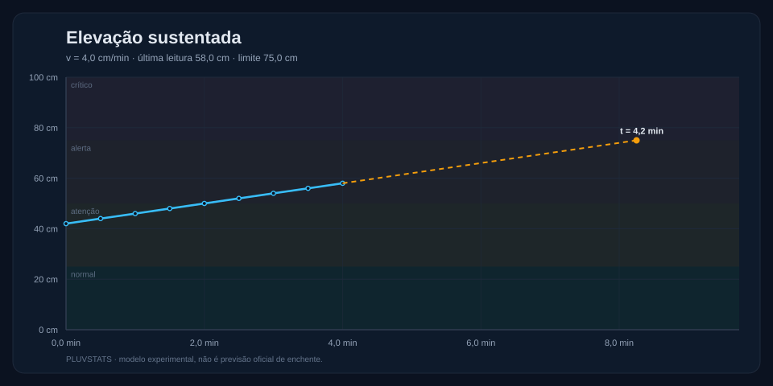
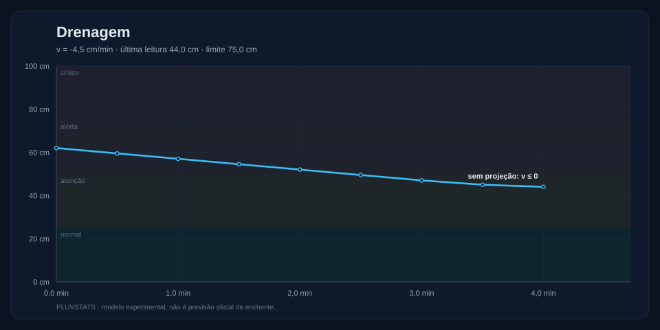
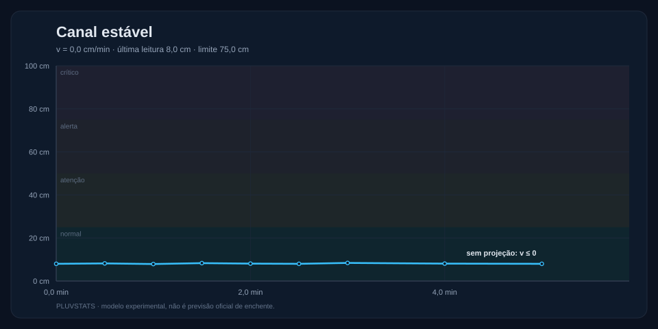
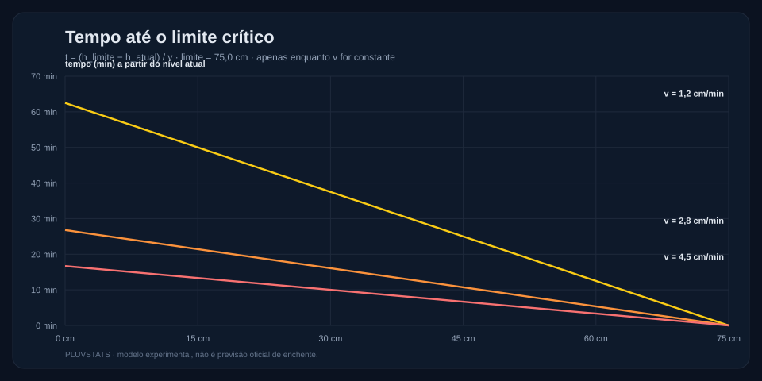

# Mathematics — PLUVSTATS

Modelo experimental de nível, taxa de elevação e tempo até um limite. É um
conjunto pequeno de fórmulas explícitas, não uma simulação hidráulica e não uma
previsão oficial de enchentes.

> **Estado:** implementado e testado (25 testes). Os gráficos são gerados a
> partir dos mesmos cenários dos testes. Nada aqui foi calibrado com dados de
> campo.

## Estrutura

```text
mathematics/
├── model/
│   └── pluvstats_model.py   funções puras, sem dependências externas
├── scenarios/               séries didáticas de distância no tempo
├── tools/plot_scenarios.py  gerador de SVG (somente biblioteca padrão)
├── graphs/                  gráficos versionados
├── tests/test_model.py      25 testes com unittest
└── README.md
```

## Notação

| Símbolo | Significado | Unidade |
| --- | --- | --- |
| `H` | altura do sensor em relação ao fundo do canal | cm |
| `d(t)` | distância medida pelo sensor até a superfície | cm |
| `h(t)` | lâmina d'água | cm |
| `v` | taxa de variação do nível | cm/min |
| `h_limite` | limite crítico experimental | cm |
| `t` | tempo estimado até o limite | min |

Geometria e limiares vêm de `shared/pluvstats.config.json`, a mesma fonte do
frontend e do backend. Valores atuais: `H = 120 cm`, profundidade do canal
`100 cm`, canal seco em `d = 112 cm` (8 cm de lâmina) e limites de
`25 / 50 / 75 cm`.

## Fórmulas

### 1. Nível a partir da distância

```text
h(t) = H - d(t)
```

O resultado é limitado ao intervalo físico `[0, channelDepthCm]`:

- `d > H` significa canal seco (`h = 0`);
- `d` muito pequeno implica lâmina maior que o canal; o modelo satura em
  `channelDepthCm` em vez de inventar profundidade.

Distâncias negativas ou não finitas são rejeitadas, porque o sensor não as
produz e aceitá-las criaria um nível fictício.

### 2. Taxa de elevação

```text
v = Δh / Δt = (h(t₂) - h(t₁)) / ((t₂ - t₁) / 60)
```

O sinal é preservado: `v < 0` indica drenagem. `Δt = 0` é inválido. A unidade de
saída é **cm/min** quando o tempo de entrada está em segundos.

### 3. Tempo até o limite

```text
t = (h_limite - h_atual) / v
```

Definições de borda:

| Situação | Resultado |
| --- | --- |
| `h_atual ≥ h_limite` | `0 min` (já está no limite ou acima) |
| `v ≤ 0` | indefinido (`None`): o modelo linear nunca alcança um limite superior |
| `v > 0` | `(h_limite - h_atual) / v` minutos |

A fórmula só é válida **enquanto `v` for constante**. Ela não incorpora chuva,
drenagem variável, saturação do solo ou capacidade do sistema de drenagem.

### 4. Projeção linear

```text
h(t + Δt) = h(t) + v · Δt
```

Também limitada ao canal. Serve para visualizar a hipótese, não para decidir.

### 5. Tendência por mínimos quadrados

Para uma série curta, a inclinação é:

```text
v = 60 · Σ((tᵢ - t̄)(hᵢ - h̄)) / Σ(tᵢ - t̄)²
```

Exige pelo menos três pontos e timestamps distintos. É uma descrição da série,
não uma previsão.

## Exemplos resolvidos

### Exemplo 1 — nível, taxa e tempo até o limite

Um sensor a 120 cm do fundo mede `d = 70 cm`:

```text
h = 120 - 70 = 50 cm
```

Dois minutos depois, a leitura é `h = 55 cm`:

```text
v = (55 - 50) / (120 / 60) = 5 / 2 = 2,5 cm/min
t = (75 - 55) / 2,5 = 20 / 2,5 = 8 min
```

Ou seja: **8 minutos** até o limite crítico se a taxa permanecer em 2,5 cm/min.

### Exemplo 2 — drenagem

O nível cai de 62 cm para 44 cm em 240 s:

```text
v = (44 - 62) / (240 / 60) = -18 / 4 = -4,5 cm/min
t = indefinido
```

A taxa negativa é registrada, mas não faz sentido calcular tempo até um limite
superior.

### Exemplo 3 — saturação física

```text
d = 5 cm   → h = 115 cm → limitado a 100 cm
d = 125 cm → h = -5 cm  → limitado a 0 cm
```

### Exemplo 4 — cenário com elevação

O cenário `rising-alert.json` sobe de 42 cm para 58 cm em quatro minutos:

```text
v = (58 - 42) / 4 = 4,0 cm/min
t = (75 - 58) / 4,0 = 4,25 min
```

## Cenários

| Arquivo | Nível inicial → final | Taxa | Tempo até 75 cm |
| --- | --- | --- | --- |
| `normal.json` | 8,0 → 8,0 cm | 0,0 cm/min | indefinido (v = 0) |
| `rising-alert.json` | 42,0 → 58,0 cm | +4,0 cm/min | 4,25 min |
| `drainage.json` | 62,0 → 44,0 cm | −4,5 cm/min | indefinido (v < 0) |

Os cenários guardam apenas `tSeconds` e `distanceCm`; o nível é derivado pela
mesma função usada nos testes. Nenhum cenário duplica os limiares.

## Gráficos

Gerados por `python mathematics/tools/plot_scenarios.py`:

### Elevação sustentada



### Drenagem



### Canal estável



### Tempo até o limite por taxa



## Testes

```bash
python -m unittest discover -s mathematics/tests -p "test_*.py" -v
```

Resultado atual: **25 testes aprovados**. A suíte cobre:

- nível, sinal e saturação física;
- rejeição de distância inválida;
- taxa em cm/min, sinal negativo e `Δt` inválido;
- tempo até o limite, incluindo `v ≤ 0` e limite já atingido;
- projeção linear e saturação;
- tendência por mínimos quadrados e validações;
- cenários, ordem temporal e valores esperados;
- uso dos limiares compartilhados.

## Limitações

1. **Modelo linear.** A extrapolação supõe `v` constante. Em campo, a taxa muda
   com chuva, drenagem e obstruções.
2. **Sem hidráulica.** Não há seção transversal, Manning, curva
   cota-vazão, escoamento superficial ou backwater. O resultado não é uma
   previsão de inundação.
3. **Sem incerteza explícita.** O modelo não propaga erro do sensor nem fornece
   intervalo de confiança. A mediana de cinco amostras no firmware reduz ruído,
   mas não substitui calibração.
4. **Saturação do canal.** O limite em `channelDepthCm` evita números
   impossíveis, mas também esconde a diferença entre "canal cheio" e
   "transbordamento".
5. **Geometria fixa.** Mudar a instalação exige novo `H`, nova faixa de
   distância válida e novos testes.
6. **Sensor de baixo custo.** HC-SR04 sofre com superfície agitada, espuma,
   detritos, vento e temperatura. Não é um medidor de nível certificado.
7. **Sem previsão oficial.** Nenhum resultado deve ser apresentado como alerta
   da Defesa Civil ou da Prefeitura de Santo André.

## Integração com o restante do projeto

- O firmware ESP32 implementa as mesmas fórmulas e limiares localmente
  (`edge/esp32/pluvstats_sensor`).
- O backend calcula `h = sensorHeightCm - distanceCm` na ingestão de hardware e
  usa a taxa suavizada do simulador nos cenários demonstrativos.
- Este módulo é a **referência legível e testável** das fórmulas; ele não é
  importado em tempo de execução pelo frontend ou pelo backend.
- Os gráficos e números deste README são reproduzíveis com os comandos acima.

## Próximos passos

1. Comparar as fórmulas com um conjunto de distâncias medidas em bancada.
2. Registrar o erro do HC-SR04 em diferentes superfícies e temperaturas.
3. Estudar uma curva cota-vazão para o canal real antes de qualquer uso
   operacional.
4. Adicionar intervalo de incerteza apenas depois de existir uma base
   experimental que o justifique.
